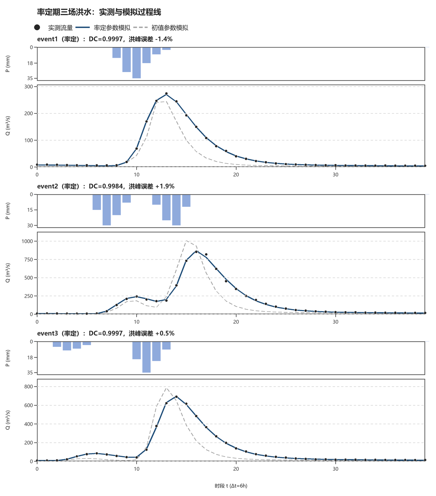

# xaj-calibration

新安江模型参数率定与洪水预报检验工具包。面向青河流域（F = 2000 km²，Δt = 6 h）的
4 场洪水过程，提供从参数率定、精度评价、不确定性分析到图件与报告生成的完整可复现流水线。

| 项目 | 内容 |
| --- | --- |
| 模型 | 三水源新安江模型（蒸散发 / 蓄满产流 / 水源划分 / 线性水库 / 马斯京根），16 个参数 |
| 率定 | 多场次目标函数 + 差分进化（DE）+ Nelder–Mead 精修 |
| 校验 | event1–event3 率定，event4 独立检验（参数全程冻结） |
| 评价 | DC、RMSE、KGE、洪峰误差、峰现时差、径流深误差，按 SL 250—2000 分级 |
| 结果 | 率定期平均 DC = 0.9993；检验期 DC = 0.9991（甲级） |

---

## 1. 特性

- **模型与参考实现逐位一致**：`src/xaj/model.py` 与 `data/raw/xaj_model_reference.py`
  在 6 组参数 × 4 场洪水下最大相对误差为 0.0（容差 1e-12）。
- **不依赖 scipy 与 matplotlib**：优化器（DE、Nelder–Mead）与绘图库均为项目内
  numpy / Pillow 实现，运行只要求 numpy、pandas、python-docx、Pillow 四个包。
- **全流程可复现**：固定随机种子 `seed=42`，DE 种群与收敛历史落盘，`05_verify.py`
  用 66 项冻结期望值校验一次运行是否与交付结果一致。
- **附带分析而非只有参数**：行为参数集（异参同效）、参数相对极差、5%–95% 预报包络、
  单因子敏感性、三水源水量平衡。
- **产物齐全**：7 张报告图、10 张三线表、一份 A4 排版的 Word 报告，均由脚本生成。

---

## 2. 快速开始

### 2.1 环境

- Python 3.12（开发环境 3.12.14）
- 依赖：`numpy`、`pandas`、`python-docx`、`Pillow`

```bash
pip install numpy pandas python-docx pillow
```

### 2.2 运行

```bash
cd xaj-calibration
python scripts/01_calibrate.py     # 率定 + event4 检验，约 2~3 分钟（96 240 次评价）
python scripts/02_analysis.py      # 异参同效、敏感性、包络，约 5 秒
python scripts/03_figures.py       # 7 张报告图，约 10 秒
python scripts/04_report.py        # Word 报告，约 5 秒
python scripts/05_verify.py        # 复现自检，66 项全部 PASS 才算成功
```

脚本内部已将 `src/` 加入 `sys.path`，无需设置 `PYTHONPATH`；路径以脚本位置为基准，
可在任意工作目录下运行。

### 2.3 一键流水线

```powershell
powershell -NoProfile -ExecutionPolicy Bypass -File scripts\reproduce.ps1
```

自动选择可用解释器、备份旧产物、逐步计时，并在最后执行复现自检。逐步操作与故障排查见
[docs/复现指南.md](docs/复现指南.md)。

---

## 3. 结果

### 3.1 精度指标

完整表见 `outputs/calibration/calibration_metrics.csv`。

| 场次 | 用途 | DC | 等级 | RMSE (m³/s) | KGE | 洪峰误差 | 峰现时差 | 径流深误差 |
| --- | --- | --- | --- | --- | --- | --- | --- | --- |
| event1 | 率定 | 0.9997 | 甲级 | 1.22 | 0.9958 | −1.41% | 0 h | −0.42% |
| event2 | 率定 | 0.9984 | 甲级 | 9.16 | 0.9970 | +1.92% | 0 h | +0.24% |
| event3 | 率定 | 0.9997 | 甲级 | 3.01 | 0.9982 | +0.54% | 0 h | −0.03% |
| **event4** | **检验** | **0.9991** | **甲级** | 3.50 | 0.9861 | +1.63% | 6 h | −0.94% |

初值参数下四场 DC 为 0.8187 / 0.7495 / 0.7363 / 0.8098，率定后四场全部达到甲级
（SL 250—2000：甲级 DC ≥ 0.90）。



### 3.2 率定参数

`outputs/calibration/best_params.csv`：

```
K=0.754004  WUM=20.047939  WLM=58.477113  WDM=26.170563
C=0.118072  B=0.348544     IM=0.001167    SM=18.240064  EX=1.812758
KI=0.170969 KG=0.161254    CS=0.626424    CI=0.556912  CG=0.952260
KE=13.446909 X=0.164837
```

### 3.3 结论

1. **外推能力**：检验期 DC = 0.9991、洪峰误差 +1.63%、径流深误差 −0.94%，峰现时间滞后
   一个时段（6 h）。参数未在检验期回调，说明率定结果没有过拟合到率定期。
2. **异参同效**：DE 末代 240 个个体全部满足率定期平均 DC ≥ 0.98，对应检验期 DC 为
   0.9965–0.9995；但参数相对极差从 CG 的 8.5% 到 IM 的 368%，等效只对输出成立，
   对参数并不成立。
3. **敏感性排序**：SM ≫ WLM > KE > B > WDM > CS > X > IM ≫ K、CI、CG。SM 推至参考
   范围上限使平均 DC 下降约 0.40，是影响最大的参数。

---

## 4. 项目结构

```
xaj-calibration/
├─ data/raw/                   原始数据（只读，含参考实现）
│  ├─ events/                 event1~event4.csv
│  ├─ basin_info.csv          流域信息与泰森权重
│  ├─ params_initial.csv      参数含义、单位、参考范围、初值
│  ├─ events_index.csv        场次索引与初始状态
│  └─ xaj_model_reference.py  参考实现（仅用于等价性校验）
├─ src/xaj/                    模型库
│  ├─ model.py                蒸散发、产流、水源划分、线性水库、马斯京根
│  ├─ calibrate.py            多场次目标函数、DE、Nelder–Mead
│  ├─ metrics.py              DC / RMSE / KGE / 径流深 / 洪峰误差 / 分级
│  ├─ validator.py            数据校验（缺测、负值、乱序）
│  ├─ io.py                   数据读取、参数边界、事件索引、泰森面雨量
│  ├─ analysis.py             行为参数集、参数分布、包络带、单因子敏感性
│  └─ plotting.py             Pillow 绘图库（折线、柱状、堆叠、包络、图例、中文）
├─ scripts/                    命令行入口
│  ├─ 01_calibrate.py         率定 + 检验 → outputs/calibration/
│  ├─ 02_analysis.py          分析与包络 → outputs/analysis/
│  ├─ 03_figures.py           7 张图 → outputs/figures/
│  ├─ 04_report.py            Word 报告 → report/
│  ├─ 05_verify.py            复现自检（66 项）
│  └─ reproduce.ps1           一键流水线（PowerShell）
├─ tests/                      57 项 unittest
├─ docs/                       复现指南、GitHub 发布指南、项目总结
├─ outputs/                    运行产物（可删除后重建）
└─ report/                     新安江模型参数率定报告.docx
```

---

## 5. 模型与算法

### 5.1 模型结构

按“先计算产流、后更新蓄水”的次序组织：

- **蒸散发**：三层蒸发，上层先蒸发，不足时按 C 系数由下层补充，深层以 K·EM 为上限；
- **产流**：蓄满产流，张力水按 `R = PE − (WM − W0) + (WM − W0)·(1 − PE/(WM−W0))^(B+1)`；
- **水源划分**：自由水蓄量 S 与 SM、EX、KI、KG 决定地表/壤中/地下径流 RS、RI、RG；
- **汇流**：三个线性水库（CS、CI、CG）并联，总出流经马斯京根（KE、X）演算至出口。

### 5.2 率定

- 决策变量：16 个参数在参考范围内归一化到 [0, 1]，消除量纲差异；
- 目标函数：`J = (1/3)·Σ(1 − DC_i) + 5·max(0, 负流量)/ΣQ_obs`，负流量作为硬约束惩罚；
- 全局搜索：DE（popsize = 15、maxiter = 400、F = 0.7、CR = 0.9），96 240 次评价，
  J 从 10⁻² 量级降至 7.64e-4；
- 局部精修：以 DE 最优个体为起点做 Nelder–Mead（最多 3 次重启），J 进一步降至 7.15e-4；
- 检验：event4 不参与任何一步，率定结束后一次性外推。

### 5.3 分析

- **异参同效**：取 DE 末代种群中率定期平均 DC ≥ 0.98 的个体作为行为参数集（240 组），
  统计各参数范围与相对极差，并绘制 event4 的 5%–95% 包络；
- **单因子敏感性**：固定其余参数，把目标参数推到参考范围上下限，记录 ΔDC；
- **水量平衡**：对比四场洪水的三水源径流深构成与实测总径流深。

---

## 6. 输出与验证

| 路径 | 内容 |
| --- | --- |
| `outputs/calibration/best_params.csv` | 率定参数 |
| `outputs/calibration/calibration_metrics.csv` | 四场精度指标 |
| `outputs/calibration/calibration_result.json` | 目标函数、DE/NM 历史、指标、边界 |
| `outputs/calibration/de_population.npz` | DE 末代种群（240 × 16）与目标值 |
| `outputs/analysis/behavioral_sets.csv` | 行为参数集 |
| `outputs/analysis/parameter_spread.csv` | 各参数分布与相对极差 |
| `outputs/analysis/oat_sensitivity.csv` | 单因子敏感性 |
| `outputs/analysis/ensemble_band.npz` | 检验期 5% / 50% / 95% 包络 |
| `outputs/figures/fig01~fig07` | 报告图件 |
| `report/新安江模型参数率定报告.docx` | A4 报告（7 图 10 表） |

复现自检：

```bash
python scripts/05_verify.py
```

把当前产物与定稿期望值逐项比对（目标函数、16 个参数、四场 DC/RMSE/洪峰/径流深、行为
参数集统计、7 张图、报告结构，共 68 项），全一致时打印“复现成功”并返回 0。若改过种子
或参数，失败是预期行为。

单元测试：

```bash
python -m unittest discover -s tests -v
```

57 项测试覆盖模型等价性（1e-12）、指标公式解析解、四类异常数据校验、数据完整性
（面雨量泰森复核、时段间隔、权重和）、目标函数结构与率定结果复现。

---

## 7. 数据

- 4 场洪水过程，每场 40 个时段（Δt = 6 h），含 6 个雨量站降水、面雨量、蒸发皿蒸发与
  出口实测流量；面雨量合计 104 / 150 / 114 / 111 mm，实测洪峰 274.1 / 853.1 / 690.5 / 403.0 m³/s。
- 流量为在模型真值上叠加约 3% 观测噪声的合成序列，用于检验模型实现与率定流程的可复现性；
  仓库只读取数据，不修改任何原始文件。
- 精度分级依据 SL 250—2000《水文情报预报规范》。

---

## 8. 已知限制

- **报告输出为 `.docx`**：不附带 PDF，因为生成环境无法调用 LibreOffice / Word 完成
  转换。需要 PDF 时，用 Word 或 WPS 打开 `report/新安江模型参数率定报告.docx` 另存即可；
  版式、页眉页脚与页码均已按 A4 设置。
- **绘图库为最小实现**：仅覆盖本项目所需图型，未实现对数轴自动刻度、多栏排版等；图件
  已按正文宽度 15.6 cm 预设尺寸。
- **单目标率定**：以 DC 为主并加负流量惩罚；若需同时优化洪峰与径流深，可改为多目标
  Pareto 搜索。

---

## 9. 许可证

[MIT License](LICENSE)，可自由使用、修改与分发，请保留版权声明。
